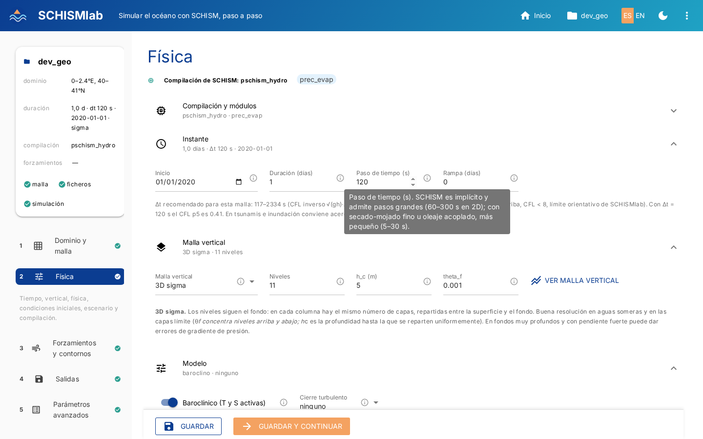
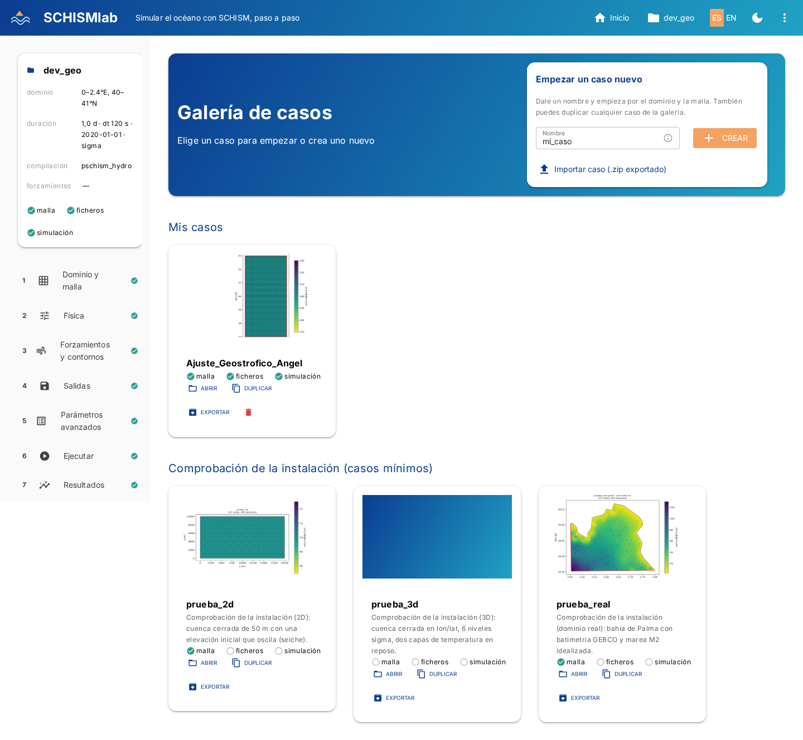
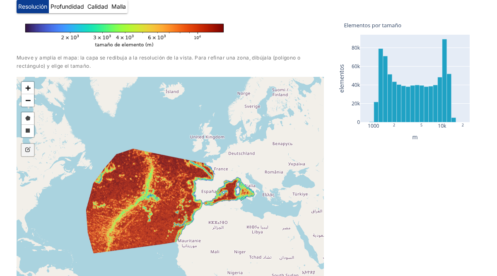
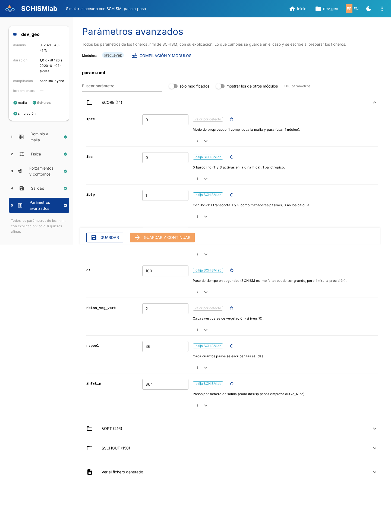
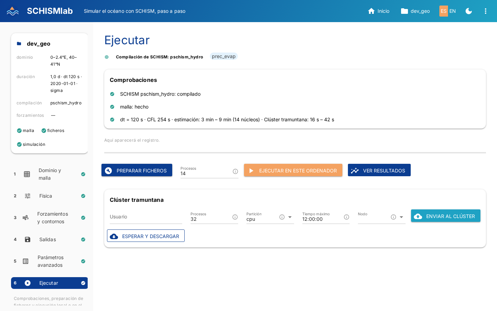
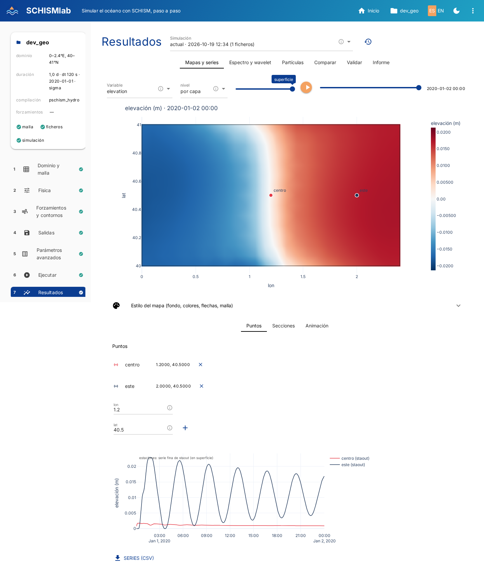

# Guía del estudiante

La interfaz (`pixi run schismlab gui`) te lleva por siete pasos. Cada caso vive en un fichero YAML que la
interfaz escribe por ti; puedes abrirlo con un editor cuando quieras ver qué hay dentro.

## 1. Inicio: elige o crea un caso

La interfaz tiene **siete pasos** en la barra lateral (Dominio y malla · Física · Forzamientos y contornos ·
Salidas · Parámetros avanzados · Ejecutar · Resultados), con una marca cuando cada uno está hecho y un botón *Guardar y
continuar* fijo al pie de cada paso (el botón principal); bajo el paso activo aparece una línea con lo que se hace en él y, al final de la barra, «Siguiente paso». En la cabecera están Inicio, el chip del caso abierto (duplicar, exportar o cambiar de caso), el idioma, el modo oscuro y el menú ⋮ con Instalación, Actualizar, Informar de un problema y Ayuda. En Inicio, la tarjeta **Empezar un caso nuevo**
crea un caso con tu nombre. Debajo del nombre, **Carpeta de la simulación** decide dónde van la malla, los
forzamientos, `param.nml`, los resultados y una copia del YAML (en una subcarpeta con el nombre del caso); por defecto
`~/.schismlab/cases`, y la última carpeta elegida se recuerda; el botón de carpeta abre un explorador para elegirla sin
teclear la ruta (con accesos rápidos y «Nueva carpeta»). El YAML del caso queda siempre en *Mis casos*, que es lo
que lista la galería. El mismo campo aparece al importar, duplicar y crear un caso desde una ejecución. Evita las
carpetas de Windows (`/mnt/...`): Dropbox y NTFS fallan a veces con ficheros grandes. Cada tarjeta de la galería tiene *Abrir* y *Duplicar* (copia editable en *Mis casos*), y las de *Mis casos* un botón de papelera que, tras confirmar, mueve el caso (YAML, malla y resultados) a `~/.schismlab/papelera`, de donde se puede recuperar.
La barra lateral muestra siempre un resumen del caso abierto: dominio, duración, compilación y forzamientos.

Cada tarjeta tiene además **Exportar**: crea un `.zip` con la configuración del caso y, si lo marcas, su malla y
entradas y sus resultados, para pasárselo a otra persona; en la tarjeta *Nuevo caso* está **Importar caso**, que lo
carga en *Mis casos*. En la cabecera, **Informar de un problema** abre una incidencia en GitHub con el diagnóstico
(versión, sistema, últimas líneas de los registros) ya relleno, y **Actualizar** comprueba si hay una versión nueva
de SCHISMlab, la instala y reinicia la interfaz (también se comprueba sola una vez al día).

Cada campo ajustable lleva un icono **(i)** al final: al pasar el ratón explica qué hace el parámetro, qué cambia
al moverlo, sus unidades y valores típicos. En *Parámetros avanzados* la explicación de cada parámetro de los
`.nml` aparece debajo de él.

{ width=800 }


{ width=800 }


## 2. Instalación (botón de la cabecera)

Arriba, la tarjeta **SCHISMlab Pro** sirve para activar la edición completa con un token de acceso, si te lo han dado.

Elige los módulos con los que compilar SCHISM (precipitación/evaporación, oleaje WWM, sedimentos, hielo,
trazadores, biogeoquímica...). Cada combinación se compila como un ejecutable distinto y queda en la lista
de compilaciones disponibles; después, en Parámetros, se elige cuál usar para cada caso.

Debajo, el estado de SCHISM y el número de núcleos de tu ordenador.

## 3. Paso 1 · Dominio y malla

La página está ordenada en tarjetas numeradas, con *Guardar* y *Generar malla* siempre a mano en una barra fija abajo:

1. **Generador**: el dominio idealizado, un rectángulo en metros con un fondo analítico.
2. **Idealizado**: tamaño del dominio (Lx, Ly), tamaño de los elementos (dx), forma del fondo y tipo de cada lado
   (pared, forzado o radiación).
3. **Malla actual**: estadísticas, CFL, tiempo estimado y visor.

Pulsa *Generar malla* y verás el mapa interactivo de profundidades y la calidad.

### Revisar la malla: estadísticas, mapa de resolución y tiempo estimado

Cuando el caso ya tiene malla (recién generada, de una sesión anterior o importada), la parte de abajo de *Dominio
y malla* muestra **Malla actual**: nodos y elementos, resolución (percentiles 5, 50 y 95 y mínimo–máximo), ángulo
mínimo, profundidades, el **CFL** y un histograma de tamaños. El mapa superpone, sobre el mapa
base, la capa elegida: **Resolución** (tamaño de elemento en escala de color logarítmica), **Profundidad**,
**Calidad** (ángulo mínimo; en rojo los elementos deformados), **CFL** o **Malla** (aristas). Al ampliar se redibuja a la
resolución de la vista y, de cerca, se ven también las aristas. Para pedir un cambio, **dibuja una zona** sobre ese
mapa: se añade como zona de alta resolución con el tamaño que elijas y puedes rehacer la malla en el momento.

**CFL.** SCHISM es semiimplícito y no tiene límite de estabilidad por arriba, pero su documentación
(*Grid generation*) pide un **CFL inverso** suficiente: CFL = (|u| + √(gh))·Δt/Δx **> 0,4** (0,2 se tolera en
tsunamis), porque con CFL bajo la advección euleriana-lagrangiana mete difusión numérica. El visor lo calcula como
SCHISM recomienda, sin |u| y con Δt/Δx donde h < 0,1 m, con el Δt de *Física*: la tarjeta da el p5 y el % de
elementos mojados por debajo de 0,4, y el Δt que haría falta; la capa **CFL** los pinta en rojo (< 0,2), naranja
(0,2–0,4) y verde (> 0,4). Si falla: sube Δt (100–400 s en barotrópico) o usa elementos más grandes donde salga rojo
(típicamente zonas muy finas y someras).

Al **pasar el ratón** por el mapa de la malla aparece un recuadro con los valores del punto: resolución, profundidad (interpolada; negativa = tierra), calidad (ángulo mínimo) y CFL del elemento, con la capa activa resaltada, y el número y la profundidad del nodo más cercano.

También se da el **tiempo estimado** de la simulación en tu ordenador, como un rango, con la
duración, el paso de tiempo y la malla vertical de *Física*. Está calibrado con simulaciones reales y se ajusta a
tu ordenador a medida que ejecutas casos.


{ width=800 }

**Retoques de batimetría.** Dibuja una zona en el visor y, en la pestaña *Retocar la batimetría*, elige qué
hacer con los nodos de dentro (el diálogo muestra cuántos son y su profundidad mínima, mediana y máxima):
fijar la profundidad (dragar un canal, rellenar un puerto o dar cota a un dique con un valor negativo), imponer
una profundidad mínima (abrir un paso que el DEM cierra) o máxima (quitar un pozo espurio), sumar un valor, o
suavizar con los nodos vecinos. *Aplicar a la malla actual* cambia `hgrid.gr3` al momento, sin remallar. Los
retoques se guardan en el caso (`mesh.bathymetry_edits`), se aplican siempre sobre la batimetría original y se
repiten solos si regeneras la malla; también sirven en una malla importada.

```yaml
mesh:
  bathymetry_edits:
    - {name: canal, op: set, value: 4, polygon: [[3.26, 39.41], [3.27, 39.41], [3.27, 39.42], [3.26, 39.42]]}
    - {name: talud, op: smooth, iterations: 5, polygon: [...]}
```

### Dominio idealizado: lados y fondo

En el dominio idealizado cada lado del rectángulo (W, E, S, N) puede ser **pared**, **forzado** (recibe el nivel o la
marea de Forzamientos → Contornos) o **radiación** (condición de Flather: deja salir corrientes y ondas sin
forzar nada; útil, por ejemplo, para ver un ajuste geostrófico sin recirculación). En el YAML: `open_sides` y
`side_types: {S: radiation, N: radiation}`.

En los dominios idealizados el fondo puede ser una forma predefinida (plano, pendiente, escalón, canal, plataforma,
monte submarino) o una **fórmula libre** («expression»): una expresión numpy en `x`, `y` (m desde la esquina
suroeste); p. ej. `100 - 80*exp(-((x-150e3)**2 + (y-60e3)**2)/(2*20e3**2))`.

## 4. Paso 2 · Física

La página está organizada en acordeones (Compilación y módulos, Instante, Malla vertical, Modelo, Condiciones
iniciales y Escenario) cuyo subtítulo resume el estado actual («3D sigma · 11 niveles», «baroclino · k-kl», «1 día ·
Δt 120 s»): fechas y duración, paso de tiempo, malla vertical (2D, sigma o sigma-z, con una descripción de cada tipo
y el botón «Ver malla vertical» que dibuja los niveles), baroclino o no, cierre turbulento y condiciones iniciales.

Las condiciones iniciales se construyen variable a variable (elevación, temperatura, salinidad, velocidad u y v)
eligiendo una **forma**: constante, frente (dos zonas con transición suave en x o y), dos capas (interfaz a una
profundidad, inclinable), gaussiana (anomalía circular), gradiente lineal o expresión libre (por ejemplo
`20 + 5*exp(z/50)`). Las posiciones son fracción del dominio (0 = oeste/sur, 1 = este/norte) y se pueden fijar
con un clic en el mapa. El mapa muestra el campo en superficie y, si depende de z, también una sección vertical
por el centro del dominio; «Densidad» combina T y S (EOS-80). Ejemplo de ajuste geostrófico: temperatura en
«dos capas» con 20 °C arriba y 12 °C abajo, interfaz a 50 m e inclinación 20 m, malla sigma y «Baroclino»
activado. Si T o S no son uniformes pero el modelo es 2D o no es baroclino, la interfaz avisa de que no afectarán
al flujo. Con velocidad inicial se escribe un estado inicial completo (`hotstart.nc`). En el YAML queda la
expresión resultante (`initial.temperature`, ...) y la receta (`initial.recipe`) para seguir editándola; también
puede escribirse a mano.
## 5. Paso 3 · Forzamientos y contornos (acordeones)

Viento (uniforme, por expresión o como esfuerzo en Pa) y mareas y nivel en los contornos (marea idealizada, tsunami,
serie de nivel), cada uno en un acordeón cuyo subtítulo resume lo elegido («sin viento», «M2 idealizada 0,5 m»).
 Si el caso no tiene contornos
abiertos, un aviso arriba lo indica. Las variables de salida y las estaciones están en el paso siguiente, *Salidas*.

En *Mareas y nivel* está la **capa esponja**: relaja la velocidad (y opcionalmente el nivel) hacia cero en una franja
junto a los contornos abiertos para absorber lo que sale y evitar reflexiones (chorros baroclinos, ondas internas, mareas
reales). Modo automático (solo con mareas reales), activada (anchura en km y tiempo de relajación en minutos) o
desactivada. No la actives donde el forzamiento debe entrar sin amortiguar (tsunami, marea impuesta). En el YAML
queda `relax_uv` en 1/s: `relax_uv = 1/(minutos·60)`.

### Serie de nivel en los contornos (marejadas sintéticas)

Para ensayar una inundación sin datos reales se puede imponer en los contornos abiertos una serie de nivel
uniforme (tipo 1 de SCHISM, fichero `elev.th`):

```yaml
boundaries:
  elevation:
    series: [[0, 0.0], [2, 1.2], [3, 2.0], [4, 1.2], [6, 0.0]]   # [horas, m]
```

## 6. Paso 4 · Salidas

Página propia del menú para decidir qué guarda la simulación:

- **Variables** por grupos (básicas 2D, atmósfera y flujos de calor, tridimensionales por nivel, avanzadas en lados
  o elementos) en una cuadrícula de casillas, cada una con su ayuda al pasar el ratón (el texto que
  explica qué se escribe y cuándo está plegado arriba). Cada escalar ocupa un proceso de escritura (scribe) y cada
  vector dos: la página muestra cuántos hacen falta y una estimación del tamaño de los ficheros.
- **Frecuencia y ficheros**: intervalo de los mapas (min), horas por fichero netCDF (pila) y, si se quiere,
  un **hotstart** periódico para reanudar o prolongar la simulación.
- **Estaciones**: puntos fijos con muestreo fino (intervalo propio) y elección de variables (η, presión, viento,
  T, S, u, v, w); se eligen con un clic sobre el mapa del dominio o tecleando coordenadas. En Resultados aparecen
  como puntos del explorador (con su serie fina de `staout` en lugar de la del netCDF) y en la pestaña Espectro.
- **Subdominio**: SCHISM solo escribe el dominio completo; con el recorte activado, al terminar la simulación
  SCHISMlab copia las salidas recortadas a un rectángulo en `outputs_recorte/`, mucho más ligeras. En Resultados
  se puede alternar entre el dominio completo y el recorte, y «Recortar ahora» recorta una simulación ya hecha.

## 7. Paso 5 · Parámetros avanzados

{ width=800 }

Todos los parámetros de `param.nml` (y de `sediment.nml` si lleva
sedimentos, etc.) con su explicación. Cada uno lleva una marca: **valor por defecto**, **lo fija SCHISMlab** (se
calcula a partir de las páginas anteriores) o **modificado** (tu valor manda). Puedes buscar por nombre o por
palabra de la explicación, ver sólo los modificados, restaurar cualquiera y ver el fichero generado. Arriba se elige
la **compilación** de SCHISM que se va a usar (ver Instalación): la lista de ficheros y parámetros se adapta a sus
módulos. Lo que cambies se guarda en el YAML del caso (`namelists:`), así la simulación es reproducible.

## 8. Paso 6 · Ejecutar

{ width=800 }

*Preparar ficheros* escribe todas las entradas de SCHISM; después *Ejecutar* en tu ordenador. La barra de progreso y el registro se actualizan en vivo, y si cambias de página y vuelves se recuperan.
Mientras corre, **Detener** (local) para la simulación y conserva las salidas escritas hasta ese momento. Si una tarea larga tarda sin novedades, el registro añade cada 10 s una línea «sigue trabajando».

## 9. Paso 7 · Resultados (pestañas: mapas y series, espectro y wavelet, partículas, comparar, informe)

{ width=800 }

Cada vez que lanzas una simulación nueva, la anterior se archiva en
`outputs_<fecha>/` con copia de su malla y parámetros; en Resultados el selector **Simulación** permite ver
cualquiera de ellas. El botón de historial junto al selector abre «Simulaciones de este caso», que lista todas con dónde y cómo se ejecutaron
(máquina, núcleos, duración, versión de SCHISMlab, tamaño) y permite verlas, borrarlas o **crear un caso** nuevo
a partir de una (con su `caso.yaml` y sus entradas copiadas), para reproducirla o modificarla.

### Mapas y series (explorador)


Encima del mapa solo están la variable, la **capa** sigma (deslizador con etiqueta), una **profundidad fija**
(el campo 3D se interpola en cada columna) o la **profundidad de isosuperficie** (con el valor: 15 para la isoterma
de 15 °C, 37 para la isohalina de 37, 27 para la isopicna σt = 27) y el deslizador de tiempo con ▶. En ese último
modo el mapa, la serie de cada punto, la sección (línea gruesa sobre el corte, sea cual sea la variable dibujada) y
el Hovmöller muestran la **profundidad a la que la variable vale ese valor**: es la forma de medir el espesor h(x, t)
de una capa. La densidad σt aparece como variable derivada (UNESCO, de T y S) si no se guardó waterDensity. El resto (fondo del mapa, escala de
colores, mínimo y máximo, **flechas** de velocidad, malla y escala fija entre instantes, velocidad de reproducción)
está en el acordeón «Estilo del mapa» debajo del mapa. El deslizador de tiempo y el botón ▶ mueven el mapa y la
sección activa a la vez. Lo que hace un clic en el mapa lo decide la subpestaña abierta debajo:

- **Puntos**: cada clic añade un punto (con nombre y color editables; las estaciones del caso ya aparecen) con su
  serie temporal superpuesta a las demás y su perfil vertical en el instante actual; botón CSV.
- **Secciones**: dos clics trazan una sección, o dibuja una línea con la herramienta de línea de la barra del mapa.
  Los extremos de las secciones se pueden **arrastrar** y el corte se actualiza. Los botones **Transversal** y
  **Longitudinal** esperan un clic en el mapa y trazan la sección perpendicular o paralela al eje principal del
  dominio por ese punto.
- El corte vertical muestra la variable con isolíneas y flechas (componente de la velocidad a lo largo del
  corte y velocidad vertical w multiplicada por el «factor w»); el botón Hovmöller dibuja distancia–tiempo.
- **Animación**: mapa o sección animados en el navegador (cada N instantes) y **Exportar MP4** de la vista
  actual (mapa con flechas o sección), que queda en la carpeta del caso.

### Diagnósticos en un cuaderno: transporte, vorticidad y función de corriente

La interfaz no calcula transporte, vorticidad ni función de corriente: son ejercicios de cuaderno. La librería trae
versiones de referencia para contrastar lo que calcules tú (`schismlab.analysis`):

```python
from schismlab.analysis import open_run, vorticity, divergence, transport, streamfunction, curl, stress_pa, ekman_pumping
ds = open_run("~/.schismlab/runs/mi_caso")
zeta = vorticity(ds)                       # dv/dx - du/dy de depthAverageVel (1/s), dims (time, node)
zeta_sup = vorticity(ds, "horizontalVel", layer=-1)
U, V = transport(ds)                       # m²/s: integral de horizontalVel en z (zCoordinates) o media·(h+η)
psi = streamfunction(ds, U, V)             # m³/s, psi = 0 en el contorno: solo cuencas cerradas sin islas
tx, ty = stress_pa(ds)                     # windStress (m²/s²) × 1000 = esfuerzo en Pa
rot_tau = curl(ds, tx, ty)                 # bombeo de Ekman: ekman_pumping(ds) = rot(tau)/(rho f)
```

Los gradientes se calculan por elemento (funciones de forma lineales) y se promedian a los nodos; todo son DataArrays
por nodo que se pintan con `plot_map` o se asignan al dataset (`ds["zeta"] = zeta`).

Profundidad de una isosuperficie (espesor de capa) desde el cuaderno:

```python
from schismlab.analysis import isosurface_depth, isosurface_series, add_density, Section
h = isosurface_depth(ds, "temperature", 15.0)          # (time, node), m; it=k para un instante
add_density(ds); h27 = isosurface_depth(ds, "density", 27.0, it=-1)
serie = isosurface_series(ds, "salinity", 37.0, node=120)
sec = Section(ds, (0.2, 40.1), (1.8, 40.1)); hx = sec.iso_depth("temperature", 15.0, it=-1); hxt = sec.iso_hovmoller("temperature", 15.0)
```

Para comparar con la teoría, el viento se puede dar directamente como **esfuerzo** (`forcing.wind.stress`, en Pa, o
la opción «esfuerzo del viento» en Atmósfera): la herramienta calcula el viento a 10 m que hace que SCHISM aplique
exactamente ese τ con la fórmula de arrastre elegida, y `windStress × 1000` lo devuelve. Las funciones
`stress_from_wind(u, v, formula)` y `wind_from_stress(tx, ty, formula)` están en `schismlab.analysis`.

### Espectro y wavelet

Para los puntos del mapa (series del netCDF) o para las **estaciones** (fichero `staout`, mucho más densas:
`output.station_interval_minutes`, 10 min por defecto; guardan η, T, S, u, v y w): serie sin tendencia,
espectro de Welch con banda de confianza del 95 %, espectro **rotatorio** de u+iv (horario y antihorario:
las oscilaciones inerciales del hemisferio norte son horarias) y **wavelet** de Morlet con el cono de
influencia sombreado, el contorno de significación al 95 % frente a ruido rojo y el espectro global. Las
líneas punteadas marcan M2, S2, K1, O1 y el periodo inercial de la latitud. La pestaña indica los periodos
resolubles (entre 2 veces el intervalo de muestreo y un cuarto del registro): con salidas horarias de dos
días no hay espectro útil; usa estaciones o registros más largos.


### Partículas, informe y comparación

- **Partículas**: suelta partículas en un disco (pincha en el mapa para fijar el centro) y síguelas con la velocidad
  guardada; trayectorias, animación y distancia media recorrida (CSV descargable).
- **Informe de la simulación**: HTML autocontenido con configuración, malla, parámetros y figuras, para entregar.
- **Comparar con otra simulación**: diferencia de la variable actual entre dos casos y series superpuestas.

